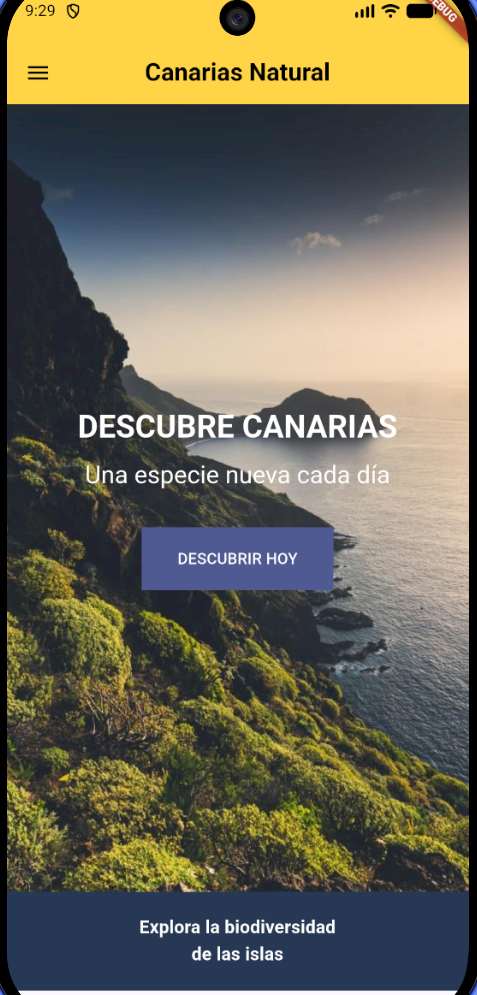
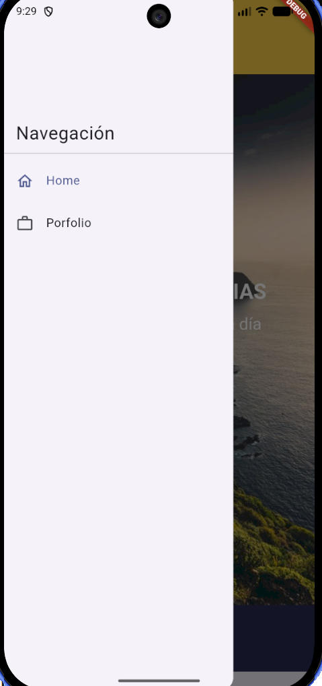
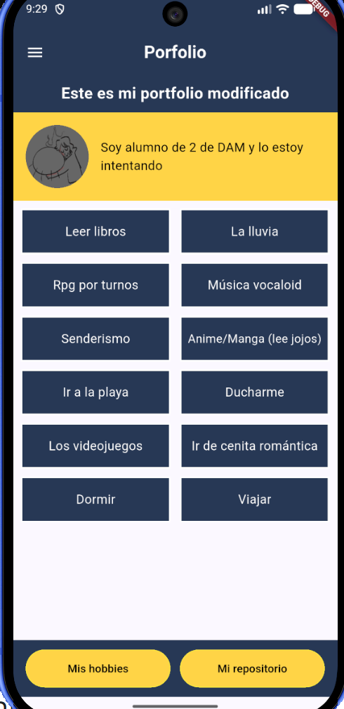
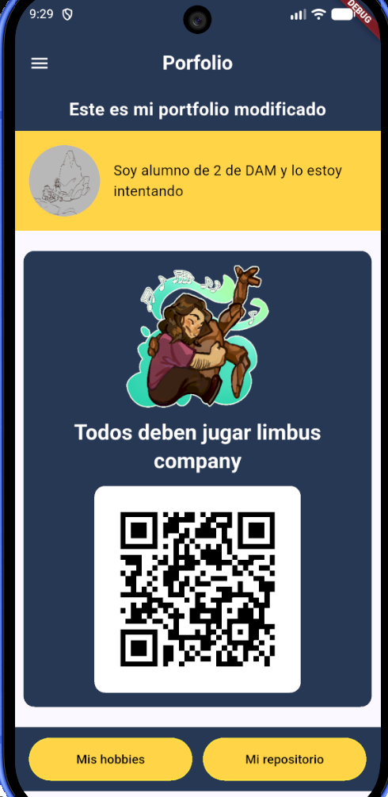

# Mi portfolio

Aplicación Flutter con navegació mediante `go_router` y un Drawer
compartido.

## Rutas

- `/`: pantalla Home.
- `/porfolio`: pantalla Porfolio con secciones de hobbies y repositorio, que se
  alternan mediante los botones inferiores.

Las pantallas están en `lib/screens/` y las opciones de navegación en
`lib/widgets/app_drawer.dart`.

