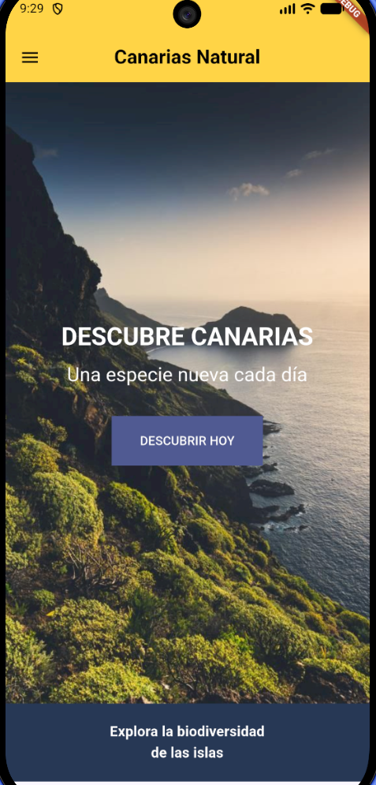
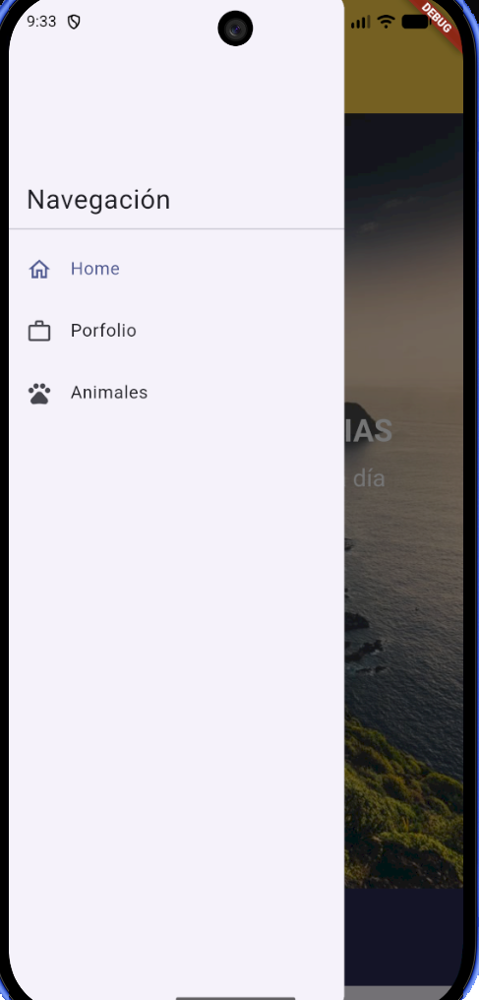
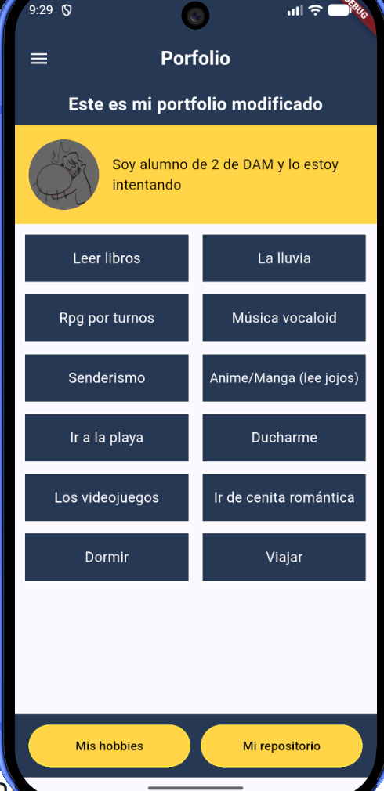
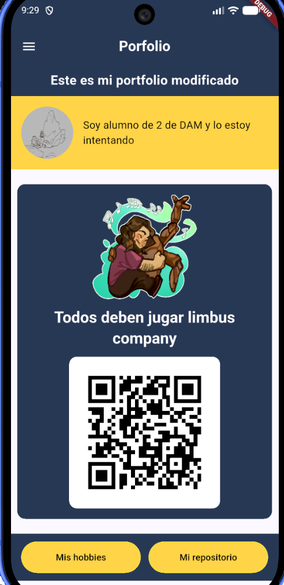
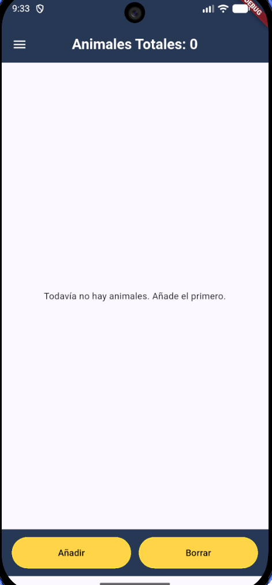
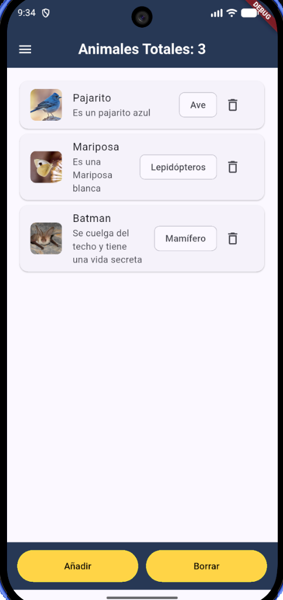
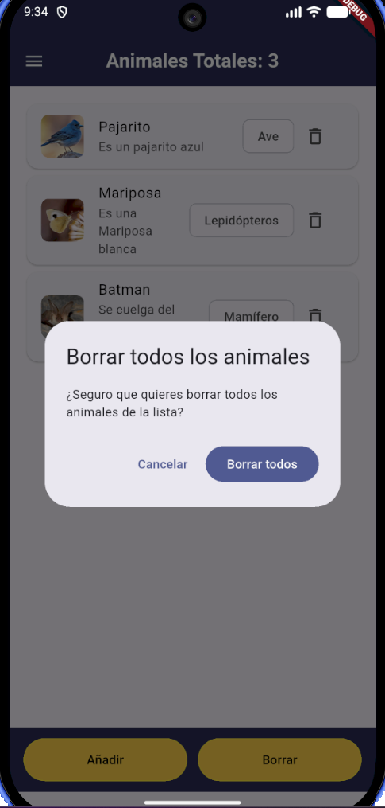

# Mi portfolio

Aplicación Flutter con navegación mediante `go_router` y un Drawer
compartido.

## Rutas

- `/`: pantalla Home.
- `/porfolio`: pantalla Porfolio con secciones de hobbies y repositorio, que se
  alternan mediante los botones inferiores.
- `/animales`: CRUD de animales; permite añadir animales por categoría, ver su
  imagen asociada y borrar elementos de forma individual o toda la lista.

Las pantallas están en `lib/screens/` y las opciones de navegación en
`lib/widgets/app_drawer.dart`.

## Capturas de la aplicación

Las imágenes de esta sección están guardadas en `lib/images/`.

